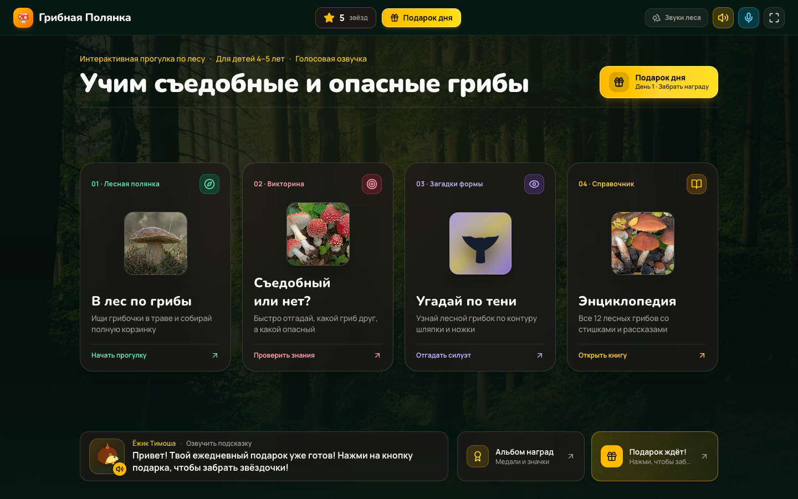
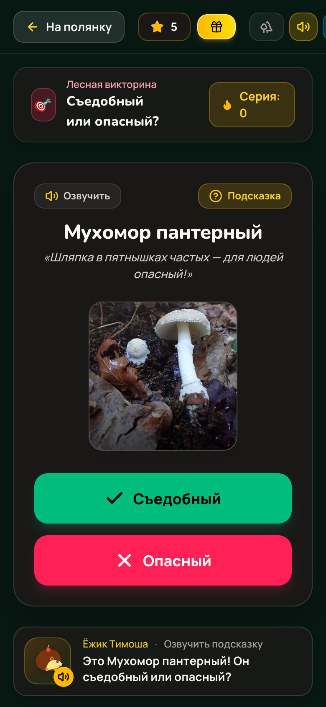
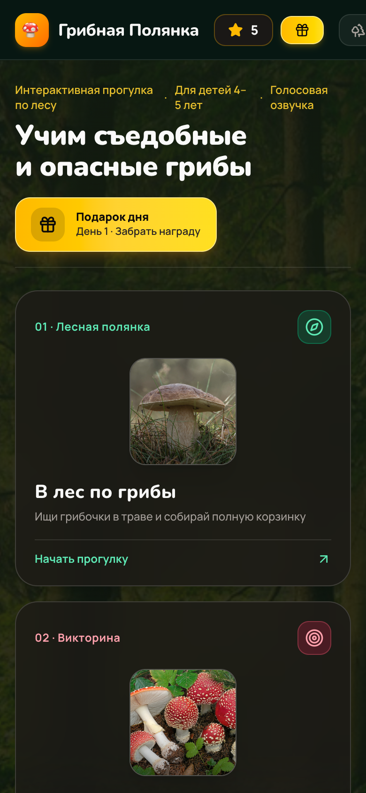

# 🍄 Грибная Полянка — Учим Грибы

Интерактивное развивающее приложение для детей **4–5 лет** по изучению съедобных и несъедобных грибов с озвучкой и играми.

**Открыть приложение:** <https://realartheria-rgb.github.io/gribnaya-polyanka/>

---

## Скриншоты

| Главный экран | Викторина |
|---|---|
|  |  |

| Энциклопедия | Мобильная версия |
|---|---|
|  |  |

---

## Возможности

- **🌲 Лесная полянка** — интерактивная прогулка по лесу: поиск грибов в траве и сбор корзинки
- **❓ Викторина** — «Съедобный или нет?» на скорость с серией правильных ответов и бонусными звёздами
- **👤 Угадай по тени** — узнай гриб по силуэту (20 уникальных очертаний)
- **📖 Энциклопедия** — 20 грибов с приметами, стишками и озвучкой
- **🏅 Альбом наград** — медали за достижения
- **🎁 Лесной календарь подарков** — ежедневные награды
- **🔊 Голосовая озвучка** (ru-RU) и звуки леса
- **💾 Сохранение прогресса** в localStorage

---

## Запуск

Приложение полностью автономно — **JS, CSS и все изображения встроены в один HTML-файл**.

```bash
# просто открыть в браузере
open index.html
```

Интернет не требуется. Работает на компьютере, планшете и телефоне.

---

## Установка на телефон (PWA)

Приложение поддерживает установку как нативное:

1. Откройте ссылку в **Safari** (iPhone) или **Chrome** (Android)
2. Нажмите **Поделиться** → **На экран «Домой»**
3. Приложение появится на рабочем столе с ярлыком

---

## Иконки приложения

| Файл | Размер | Назначение |
|---|---|---|
| `icon.png` | 512×512, скруглённые углы | favicon, PWA, веб |
| `icon-1024.png` | 1024×1024, квадрат без прозрачности | **App Store Connect** |

> ⚠️ Для App Store Connect загружайте именно `icon-1024.png` — Apple требует квадрат 1024×1024 без альфа-канала и без скруглений (углы Apple округляет сама).

---

## Технологии

React 19 · Vite · TypeScript · Tailwind CSS 4 · Web Audio API · Web Speech API

Собрано в один самодостаточный HTML-файл (~5 МБ).

---

## Сборка из исходников

```bash
npm install
npm run build
```

Исходники — в папке `src/`.
